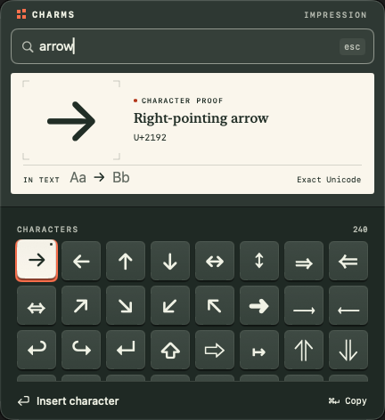
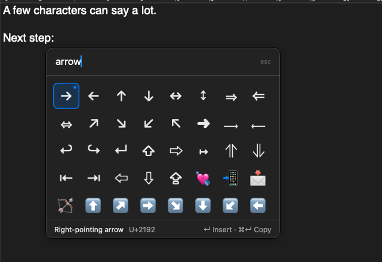
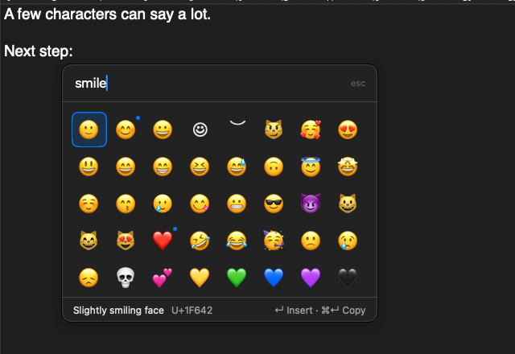
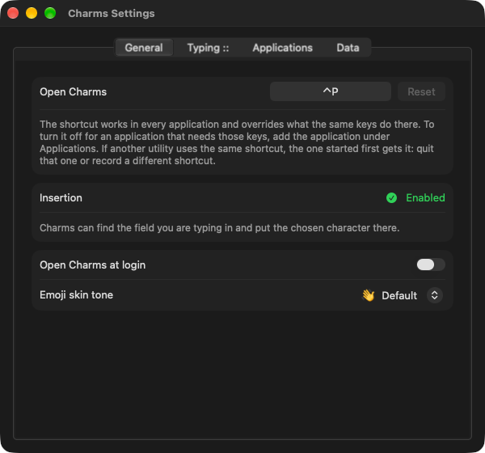

# Charms

> [!IMPORTANT]
> LLM disclosure: This codebase was written with substantial help from large language models: AI coding agents working from the [`AGENTS.md`](AGENTS.md) brief in this repo.

**Latest release:** v<!-- version -->0.1.0<!-- /version --> · [Download](https://github.com/L-K-M/Charms/releases/latest)

Charms is a small Mac menu-bar utility for typing the characters your keyboard
does not have: arrows, symbols, punctuation and emoji. Press a shortcut where
you are typing, type a name, press Return, and keep typing.

What sets it apart is where it opens. The picker appears on the display that
holds your typing, right beside the text cursor, and never on top of the line
you are writing, wherever the mouse happens to be.

### Impression: the composing picker

Choose a character on a little type block. See it large on a paper proof and
at writing size between “Aa” and “Bb”. Then press Return and keep writing.
The specimen is demonstration text, not a reading of your document. The name
and exact Unicode sequence sit beside the proof; guides for spaces and
combining marks are labelled and never inserted.



The raised selection and short stamping response give choosing a character
some weight, without adding a step or delaying insertion. Hover never changes
what Return inserts. Motion follows Reduce Motion; the opaque paper and
composing tray do not depend on transparency. Sound is intentionally absent.

Impression is the development picker, not a tagged release. Read the
[three concepts and design decision](docs/design/impression.md),
[build and run it](docs/design/prototype.md), or
[watch the native keyboard demonstration](docs/design/impression-demo.mp4).
The catalogue and insertion policy are unchanged.

### Released picker (v0.1.0)



## Using it

| Key | What it does |
| --- | --- |
| `⌃P` (configurable) | Open the picker; press again to close it. |
| Typing | Search by name, keyword or alias: `arrow`, `check`, `infinity`, `cmd`, `->`, `nbsp`. A pasted character or `U+2192` finds it exactly. |
| `→` at the end of the search, `↓`, `Tab` | Move into the results. Arrow keys then move between cells; `↑` from the first row returns to the search. |
| `↵` | Insert the selected character where you were typing. The first one is selected as soon as the picker opens: your first favourite, or the best match once you search. |
| `⌘↵` | Copy it instead. |
| `⌘D` | Add the selected character to your favourites, or remove it. |
| `⌃↵` | Open the selected character's menu: skin tones, moving a favourite, Copy. |
| `esc` | Close without changing anything. |

Before you search, the picker shows your favourites and the characters you
used most recently. Names and keywords find emoji too:



### Typing `::` instead of the shortcut

Switch this on in Settings or in the menu-bar menu. Then type two colons at
the start of a field or after a space and keep going: `::arrow`, Return. The
colons and the name are replaced by the character. Escape closes the picker
and leaves the colons in your text; the name you typed into the picker is not
put there. It is off by default, and off in terminals, code editors,
password managers and applications that have their own `:shortcodes:`; the
list is yours to edit.

### Applications that hide their text fields

Some applications, those built with Electron among them, do not report where
you are typing unless an app requests it. Charms can then only copy. The
first time it meets such an application it asks whether to turn this on for
that application. If you agree, Charms requests it then and each time the
application starts; it takes about two seconds to take effect, and the
application may use a little more memory and processor time. Switching to
another application while the question is open does not pull you back.
Your remembered answers are listed under Settings, General, where Ask Again
forgets all answers, including a temporary Not Now in the current run.

### Settings

Change the shortcut, choose a default emoji skin tone, or start Charms at
login in Settings.

In development builds, **Appearance** offers three picker themes:
**Impression** (warm paper and vermilion), **Blueprint** (navy and cyan), and
**Plum** (rose paper and apricot). Choose System, Light or Dark independently.
Choices take effect immediately and survive relaunch. The preview uses the
same proof and character blocks as the picker. Restore Default Appearance
returns to Impression and System. [Theme details](docs/design/themes.md).



### Permission

Charms asks for one permission, Accessibility, and explains it before the
system prompt appears. (macOS 27 lists it as Device Control and Data Access.)
It uses it to find the field you are typing in and to send the chosen
character there. Without it Charms still opens, searches and copies; you paste
yourself. Nothing leaves your Mac: see [PRIVACY.md](PRIVACY.md).

If insertion stops after replacing the app, choose Enable Insertion in
Settings, General. In the system list, switch Charms off and on again if it
is already enabled.

## Installing

Download the `.dmg` from the [latest release](https://github.com/L-K-M/Charms/releases/latest),
drag Charms to Applications, and open it. Releases are not signed with a
Developer ID or notarized, so macOS refuses the first launch. On macOS 15 or
later, try to open Charms once, dismiss the warning, then click Open Anyway
under Privacy & Security in System Settings. On macOS 14, Control-click the
app, choose Open, then Open. Requires macOS 14 or later.

Both archives are universal (Apple Silicon and Intel); only Apple Silicon
has been runtime-tested. [SHA-256 checksums](https://github.com/L-K-M/Charms/releases/latest/download/SHA256SUMS.txt)
identify the published files, not a claim of reproducible builds.

If another utility already uses Control-P, for example PopChar, quit it or
change one of the two shortcuts; whichever registered first wins.

To remove Charms, switch off "Open Charms at login" in its Settings, quit it,
delete the app, and optionally delete `~/Library/Application Support/Charms`
(favourites and recents) and the Accessibility entry in System Settings.

What has been tested, and on which systems, is recorded in
[docs/compatibility.md](docs/compatibility.md). The released-app screenshots
under `docs/screenshots/` show v0.1.0 on macOS 27. Impression's separate
development captures live under `docs/design/`. Other macOS versions may look
different.

### Reinstalling or going back

Quit Charms before replacing the app with a copy from
[Releases](https://github.com/L-K-M/Charms/releases). Replacing the app keeps
your settings, favourites and recents.

Before trying an older version, back up `~/Library/Application Support/Charms`
and export your preferences with
`defaults export ch.lkmc.Charms Charms-preferences.plist`. Restore data and
preferences from a backup made for that version if needed. Replacing the app
does not reverse a data migration. This first release uses library schema 1;
downgrades across schema versions are unverified.

## Building

```sh
swift build                       # the package
swift test                        # CharmsCore and catalogue tests
swift run CharmsCatalogTool check # the committed catalogue matches the pinned data
./scripts/build-app.sh            # dist/Charms.app, ad-hoc signed (--debug, --universal)
./scripts/e2e.sh                  # drives the built app with real keys (see below)
```

`scripts/e2e.sh` starts the built app with a temporary home directory, opens
a test window (`CharmsHarness`), and checks insertion, Undo, Escape, copying,
placement, the typed `::` and the password-field rule with real key events. It
needs a terminal that has the Accessibility permission and uses the keyboard
for about two minutes, including checks in every theme and both explicit
appearances.

`scripts/build.sh` / `scripts/release.sh` wrap the shared `lkm-build` /
`lkm-release` engines; releases are cut by tagging. See [CICD.md](CICD.md).
Requires macOS 14+ and Xcode 26 (any Xcode 16+ builds the package; CI pins the
toolchain). There are no dependencies.

macOS ties the Accessibility grant to the app's signature, and an ad-hoc
signature is different in every build. For a build you rebuild often, sign
with a stable identity so the grant survives:

```sh
CODE_SIGN_IDENTITY="Apple Development" ./scripts/build-app.sh
```

The character catalogue (`Resources/catalog.txt`) is generated from the
Unicode and CLDR files pinned under `Data/` and from the curated aliases in
`Data/aliases.tsv`. After changing either, run
`swift run CharmsCatalogTool generate` and commit the result.

The design, and the measurements behind it, are in [PLAN.md](PLAN.md).

## License

Charms's own code is released under the [Unlicense](LICENSE). The character
names and keywords in the bundled catalogue come from the Unicode Character
Database, Unicode Emoji data and CLDR, which keep their own license; see
[THIRD_PARTY_NOTICES.md](THIRD_PARTY_NOTICES.md).
