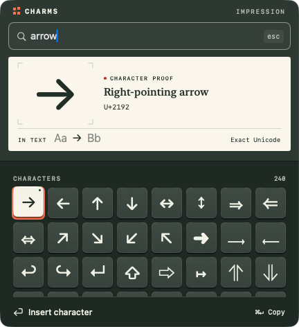
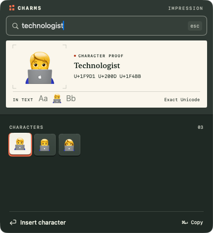

# Running Impression

Impression is a working interaction prototype inside Charms' native Mac app,
not a separate mockup or a new release. It uses the bundled Unicode/CLDR
catalogue, real search, favourites, recents and the existing insertion pipeline.
The original concept branch is `design/impression-picker`.

## Run

Requires macOS 14+ and a Swift 6 toolchain. Quit another running copy of Charms
so it does not own the shortcut.

```sh
./scripts/build-app.sh
CHARMS_HOME="$(mktemp -d -t charms-impression)" dist/Charms.app/Contents/MacOS/Charms
```

The temporary home isolates preferences, favourites and recents. On first
launch, choose Enable Insertion or Browse and Copy. Accessibility is needed
for insertion, not for searching and copying. For repeated local builds on a
machine with a development identity, use
`CODE_SIGN_IDENTITY="Apple Development" ./scripts/build-app.sh` to retain the
grant across rebuilds. No privacy database reset or automatic grant is needed.

Click a text field in a test document, then press Control-P. Search `arrow`,
`infinity`, `technologist`, `U+0301` or `U+00A0`. Try the optional `::` trigger
only after explicitly enabling it in Settings.

## A ten-second demonstration

1. Open in a text field and type `arrow`.
2. Press Right twice, then Left. Watch the selection saddle move between
   raised type blocks while the paper proves the chosen glyph at two scales.
3. Hold Return for about half a second: the block sinks and the proof presses
   down. Release. The character is dispatched once and typing resumes.
4. Open again, search `technologist`, choose a neighbour and press Return.
   The whole joined sequence is inserted, not just its first scalar.

A normal tap is still sufficient. Do not hold Return for a full second: the
existing safety gate deliberately expires a held activation and asks you to
press again. Escape during pressure cancels without inserting; the panel
keeps the keyboard until the held key comes up.

[Watch the actual keyboard demonstration](impression-demo.mp4).





## Interaction contract

- The native AppKit field editor retains IME composition, selection, Undo,
  paste and ordinary query editing. It stays first responder. Control-Return
  is intercepted at the panel boundary to avoid the native field menu; other
  command routing is unchanged.
- The first favourite or first search result is selected immediately.
  Return acts on that choice. Down, Right at query end and Tab enter grid
  navigation. Typing returns to editing the query.
- Hover lifts an edge over 120 ms without moving selection or the proof.
  A click activates a block once. Clicking the proof does nothing.
- A new selection is visible immediately, with a 3-point stamping cycle
  lasting about 180 ms. Pressure is immediate; blocks settle over 80 ms.
  There is no animated dismissal or minimum insertion delay. The vermilion
  saddle uses a 200 ms spring response.
- `pressedItem` is a presentation projection of the session machine's frozen
  choice, not another authority for dispatch. The proof cannot change a
  pending insertion. Escape, expiry and fallback remove pressure.
- The large preview and 16-point “Aa / Bb” specimen are illustrations, not
  the source document or a prediction of its font. Spaces and combining
  marks say “Preview guide only”; the guide never enters the payload.
- Names and full scalar sequences remain available to accessibility. Long
  sequences scroll horizontally and display a bidirectional cue. A cream
  block, outline and navigation underline supplement colour. Contrast mode
  strengthens labels and rules; Reduce Motion removes movement and scale.
  All major surfaces are opaque, so Reduce Transparency has no visual work
  to suppress. There is intentionally no sound or haptic requirement.
- Insert and Copy remain literal, clickable actions. Copy-only mode is
  labelled. There is no claim that another app acknowledged delivery.
- Control-Return and the context menu retain favourites, reordering and valid
  skin-tone variants. Command-D, Command-Return and Escape still work.

## Verification and boundaries

See [compatibility](../compatibility.md#impression-prototype) for the final
checks and their exact scope. Re-run these after picker changes:

```sh
swift build
swift test
swift run CharmsCatalogTool check
CODE_SIGN_IDENTITY="Apple Development" ./scripts/build-app.sh
./scripts/e2e.sh
```

All 27 scenarios passed on the final build. The five additions check stable
selection under hover, empty-result recovery, exact insertion without preview
guides, a non-actionable proof, and keyboard access to character actions. The
last test exposed an existing macOS 27 routing bug: Control-Return reached the
native query menu instead. It was observed failing before the panel-level
key-equivalent fix and passing afterwards. The mouse coordinates in the
script follow the new 432 by 472 point panel and its section heading.

Motion review found a real defect in the first version: identity replacement
and opacity transitions could leave the paper briefly blank during rapid
queries. The final version keeps the specimen continuously present,
suppresses implicit glyph/font crossfades and animates only pressure.
Reproduce the check by typing `technologist` with
30 ms between characters, immediately stepping Right, and recording the
panel. No result-bearing frame should contain an empty proof.

The committed images and silent video capture the actual app with isolated
storage against CharmsHarness, with staged example text. They are not
composites. The video is cropped to that staged source line and the picker;
no real documents or clipboard contents are included.

This slice does not redesign Settings, the menu bar, onboarding, icon,
search/ranking or transport. Larger-text reflow, listening with VoiceOver,
input methods and older-Mac runtime testing remain explicit release gates,
not claims established by these captures. The fixed-size prototype costs
152 points more vertical space than the previous picker. The existing
placement engine receives the new size; the caret-line check is rerun, but
small displays and mixed-scale multi-monitor use need a fresh manual pass.
