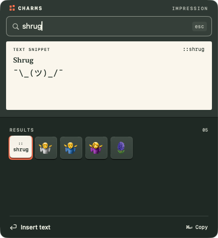
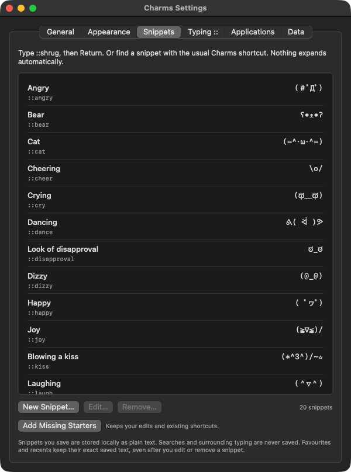

# Text snippets

Charms can insert short, saved text as well as individual symbols and emoji.
Nothing expands automatically. With typed invocation enabled, type `::shrug`
and press Return to replace the marker with `¯\_(ツ)_/¯`. Or open Charms with
the normal shortcut and search for `shrug`. Escape keeps the original field
and clipboard unchanged, just as it does for characters.

## Your snippets

Open **Settings → Snippets**. Choose **New Snippet…**, enter a name, shortcut
and replacement, then Save. Shortcuts leave out `::`, start with an ASCII
letter, and contain 1–32 letters, digits or hyphens. They are case-insensitive
and unique. Names are single-line and limited to 80 UTF-16 units.

Replacement text is single-line, with a maximum of 64 UTF-16 units. Most
characters use one unit; many emoji use more. The editor shows the count.
Tabs, line breaks, control characters and directional overrides are rejected.
Joiners, variation selectors, combining marks, ordinary spaces and emoji tag
sequences are preserved exactly. There are no templates, variables or scripts.
Leading and trailing spaces are not trimmed.

Select a snippet to Edit or Remove it. Cancelling the editor discards only
its unsaved draft. A failed save keeps the active list unchanged and reports
the failure. **Add Missing Starters** restores deleted starters without
replacing entries you edited or shortcuts claimed by your own snippets.
The list is capped at 500 entries.

Both images are captures of the signed universal app on macOS 27.0.1, with
isolated storage and staged text, on 11 November 2026.

## In the picker

- An exact shortcut takes priority over an emoji alias. `shrug` selects the
  text face first; the shrug emoji is still another result.
- Name and shortcut-prefix matches also appear in results. Literal Unicode,
  code-point and exact catalogue-name matches retain priority over these
  broader matches. The catalogue's internal ranking is unchanged.
- Snippet tiles show their shortcuts instead of shrinking a sentence to a
  tiny glyph. The proof shows the complete short replacement across its
  width. Its accessibility value contains the shortcut and exact text.
- Return inserts; Command-Return copies. Hover does not change the choice.
- Favourites and recents save the exact replacement and its snippet label.
  Editing or deleting the source snippet never rewrites those saved copies.
  Remove an old favourite explicitly if you no longer want that text.

Typed invocation still requires Accessibility permission and still observes
its application exclusions and field/boundary checks. Snippets do not extend
which applications Charms can safely target.

## Storage and privacy

Snippets are saved locally as **plain text** in `snippets.json` beside the
preferences and library, normally under
`~/Library/Application Support/Charms/`. `CHARMS_HOME` redirects all three.
Only text you deliberately save as snippets, favourites or recents is stored;
Charms does not save searches or surrounding document text. Snippet content
is never included in diagnostics. No network access is added to the app.

The file has its own schema and owner-only permissions. Saves use an atomic
replacement. Starters are seeded only when the file is missing; deleting all
entries and relaunching leaves the list empty. An unreadable, invalid or
unsupported-schema file is left untouched, with editing disabled. Repair or
restore it while Charms is closed, then relaunch or choose Retry Loading.
Back up the file before editing it outside Charms.

## The 20 starters and their sources

Researched and fetched on **11 November 2026**. These are conventional text
faces from popular public lists, not a statistically ranked top twenty.
Names and shortcuts below are Charms' own labels. Individual strings were
checked against the fetched pages, not copied from an unverified generated
list. No source pages are fetched at runtime.

Sources:

- **W:** [Wikipedia, List of emoticons](https://en.wikipedia.org/wiki/List_of_emoticons),
  including its Eastern/table-flip examples. Wikipedia contributors publish
  the article under its linked CC BY-SA terms.
- **K:** [Kaomoji: Japanese Emoticons](https://kaomoji.ru/en/).
- **T:** [Text Faces](https://textfac.es/).

| Shortcut | Name | Exact replacement | Source |
| --- | --- | --- | --- |
| `shrug` | Shrug | `¯\_(ツ)_/¯` | W, K, T |
| `tableflip` | Table flip | `(╯°□°)╯︵ ┻━┻` | W |
| `unflip` | Put the table back | `┬─┬ノ( º _ ºノ)` | W, K, T |
| `lenny` | Lenny face | `( ͡° ͜ʖ ͡°)` | W, K, T |
| `disapproval` | Look of disapproval | `ಠ_ಠ` | W, K, T |
| `joy` | Joy | `(≧∇≦)/` | W |
| `happy` | Happy | `( ﾟヮﾟ)` | W, T |
| `sad` | Sad | `T_T` | W, K |
| `cry` | Crying | `(ಥ﹏ಥ)` | K, T |
| `surprise` | Surprised | `(°◇°)` | W |
| `cheer` | Cheering | `\o/` | W |
| `party` | Confetti | `(ﾉ◕ヮ◕)ﾉ*:･ﾟ✧` | K, T |
| `laugh` | Laughing | `(＾▽＾)` | W, K |
| `angry` | Angry | `(＃ﾟДﾟ)` | W |
| `kiss` | Blowing a kiss | `(*^3^)/~☆` | W |
| `bear` | Bear | `ʕ•ᴥ•ʔ` | T |
| `cat` | Cat | `(=^･ω･^=)` | K |
| `dizzy` | Dizzy | `(@_@)` | W |
| `dance` | Dancing | `ᕕ( ᐛ )ᕗ` | W, K |
| `peace` | Peace of mind | `ヽ(´ー｀)ﾉ` | W |

Variants matter: the table-flip entry uses ASCII `)`, not fullwidth `）`.
The bear has no internal spaces. Lenny includes U+0361 and U+035C combining
marks. Some web copies of shrug/table flip contain hidden word joiners or
BOM characters; those copies were not used. Starters contain no control,
bidi-formatting or zero-width formatting characters.
